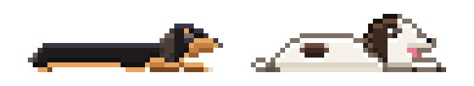
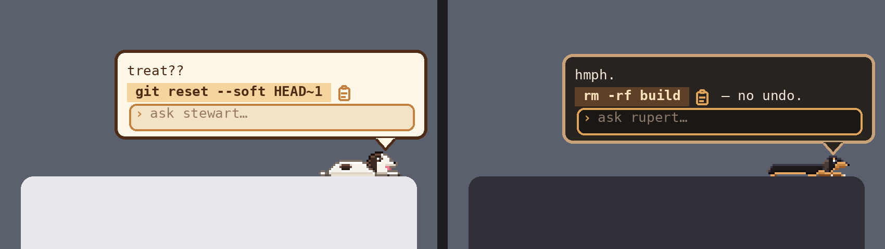
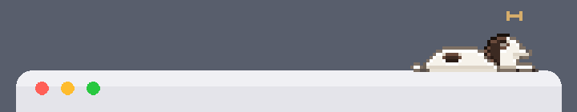
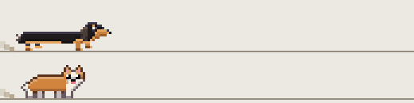
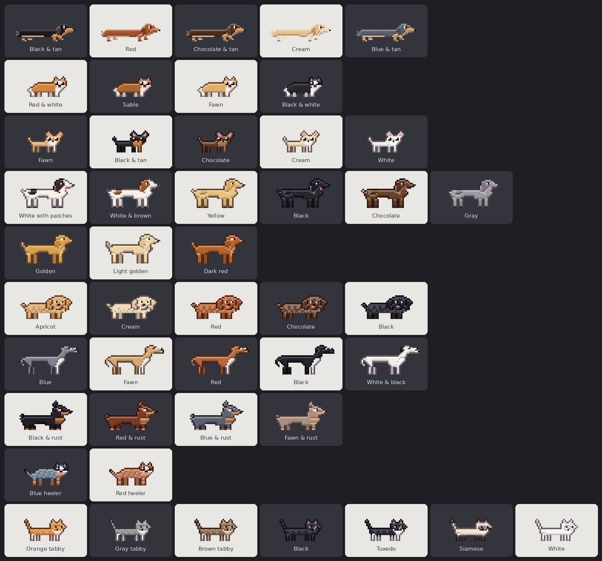
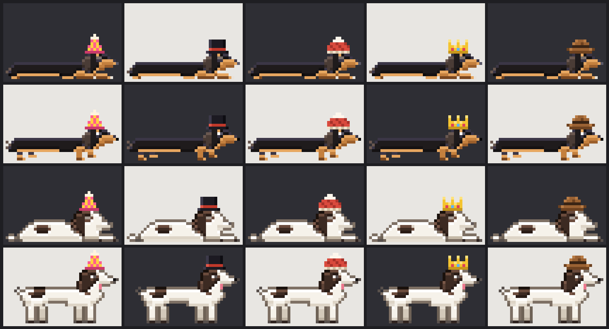

<p align="center"></p>

<h1 align="center">Rupert</h1>
<p align="center"><b>It's about time your pets paid the rent.</b><br>
A pixel pet that naps on your active window and answers quick questions in as few words as possible.</p>

---

You're deep in it. Forty messages into a session with your AI agent, it finally understands the codebase, the file is half refactored, and everything is going great. Then you forget how to jump to the top of the file in vim.

You could ask the agent. It would stop editing, burn a chunk of context, and come back with three paragraphs about vim's motion commands, a table of related shortcuts, and an offer to set up your `.vimrc`. All you wanted was `gg`.

Or you could ask your dog.

```
you:     vim top of file
rupert:  gg
         hmph.
```

Rupert sleeps on top of whatever window you're using. Click him (or press **⌃⌥R** / **Ctrl+Alt+R**), ask the dumb little question, copy the answer, and get back to work. Your agent never knows you forgot. Your context window stays clean. Rupert goes back to sleep, mildly annoyed.

<p align="center"></p>

## Why a dog

A terminal command you forgot isn't worth reaching for a new tab or parsing an 3 paragraph LLM response, and a sleeping dachshund is easier to like than a search bar.

- **He answers in as few tokens as possible.** The command comes first, highlighted, with a clipboard icon next to it, plus a two-word comment at most. No preamble, no "Great question!", no bullet points about alternatives.
  ```
  you:      git undo last commit keep changes
  rupert:   git reset --soft HEAD~1   📋
            zzz.
  ```
- **He's always there, never in the way.** He follows the window you're working in, tucks into the title bar or menu bar when a window is maximized, and naps on the Dock when you minimize.
- **He's separate from your real work.** His own tiny chat, his own model, his own small token budget. Nothing he says ends up in your agent's context.
- **Works with any AI provider, including free local ones.** Anthropic, OpenAI, Gemini, OpenRouter, Groq, Mistral, xAI, DeepSeek, or a local model on your own GPU through Ollama or LM Studio. Small, cheap models are all he needs.
- **macOS, Windows and Linux.**

## He's also a pet, which helps

<p align="center"></p>

- **Pet him.** Rub your cursor back and forth over him and he wiggles and floats hearts. He also perks up when you copy his answer or say thanks.
- **He has opinions about danger.** Hand him a question whose answer is `rm -rf` or `git push --force` and he gets visibly nervous. Fair.
- **He knows what time it is.** Ask him something at 2 a.m. and he may suggest bed.
- **He wanders, as much as you let him.** Right-click → **Activity**: *Lively by time of day* (morning zoomies, afternoon slump, asleep all night), *Wander sometimes*, or *Stay in the corner*. Drag him anywhere along the top of the window.
- **Zoomies.** Now and then a walk turns into a sprint: a few dashes back and forth, kicking up dust, then a flop and some panting. More often in the morning and evening, and much more often for zoomy and golden-retriever-energy pets. Rupert, being Rupert, rarely bothers.

<p align="center"></p>
<p align="center"></p>

- **Hats.** Party hat, top hat, beanie, crown or cowboy hat. Right-click → **Accessories**. This is not optional, morally.
- **Bring your own pet.** Upload a photo and the AI draws your actual pet in 16-bit pixel art, or pick from 10 breeds in 46 colors: dachshund, corgi, chihuahua, hound or lab, golden retriever, goldendoodle, greyhound, Doberman, cattle dog, or a cat. Then give it a personality: grumpy, golden retriever energy, zoomy, always hungry, sleepy, dramatic, or for cats, aloof, lap cat or chaotic gremlin.

Two pets come built in, both real dogs inspired by my own pets who always hang out with me while I code.. **Rupert** is a sleepy, grumpy black-and-tan dachshund who resents being woken but always helps. **Stewart** is a goofy white hound who will help you if it leads to snacks.

```
you:      list running docker containers
stewart:  docker ps
          treat??
```

## Install

### macOS

Requires the Xcode Command Line Tools (`xcode-select --install`).

```sh
cd macos
./build.sh
source ~/.zshrc
rupert on
```

### Windows

1. Install [Python 3.9+](https://www.python.org/downloads/) and tick **Add python.exe to PATH**.
2. Double-click `windows-linux/install.cmd`.
3. Open a **new** terminal and run `rupert on`.

### Linux

```sh
sudo apt install python3-venv libxcb-cursor0    # Debian/Ubuntu
cd windows-linux
./install.sh
rupert on
```

Window following needs X11. On Wayland the pet runs through XWayland and can only follow X11 apps, because Wayland doesn't let one app see where another app's windows are.

## Make your own pet

Right-click → **Pets** → **Add new pet…**, give it a name, then either:

- **Upload a photo.** The AI draws your pet from it, its shape, coat and markings. Pick a personality or let it guess one from the photo.
- **Pick a breed and color.** No AI drawing needed, so it's instant and works with any model.

<p align="center"></p>

Breeds: dachshund, corgi, chihuahua, hound or lab, golden retriever, goldendoodle, greyhound, Doberman, Australian cattle dog, and cat. Small breeds stay small on screen.

| Personality | Sounds like |
|---|---|
| Grumpy | `hmph.` `fine.` |
| Golden retriever energy | `best day!` `love you!` |
| Happy and zoomy | `zoom!!` `again!!` |
| Always hungry | `treat??` `snack?!` |
| Sleepy | `yawn.` `nap now.` |
| Dramatic | `tragic.` `how dare.` |
| Aloof cat | `whatever.` `as if.` |
| Cuddly lap cat | `purrr.` `pet me.` |
| Chaotic gremlin | `heh heh.` `knocked it.` |

## Use

| | |
|---|---|
| **Click the pet**, or press **⌃⌥R** (Mac) / **Ctrl+Alt+R** (Windows, Linux) | Open or close the chat box from anywhere. The input grows as you type (up to 5 lines). Enter sends, Shift+Enter adds a line, Esc or clicking away closes. |
| **Clipboard icon** next to the command | Copies just the command, not the warning or personality line. |
| **Rub the cursor** back and forth over the pet | Pet it. Hearts. |
| **Drag the pet** left or right | Move it to a new spot along the top of the window. It stays there a few minutes before wandering again. |
| **Right-click** | Pets (switch, add, edit, remove), AI provider, model, accessories, activity, appearance (auto, light or dark), copy, clear, quit. |
| `rupert on` / `off` / `restart` | Run Rupert. |
| `stewart on` / `off` / `restart` | Run Stewart, swapping out whoever is awake. |
| `<name> on` / `off` / `restart` | Run a pet you made, by its name: `biscuit on`. Works the moment you save the pet, in any open terminal. |
| `pet <name> on` / `off` | The same, for a pet whose name is already a command (a cat named `cat`, say). |

Names are typed without spaces or symbols, so "Sir Waffles" answers to `sirwaffles on`. On Mac and Linux, open a new terminal once after updating. Rupert's command hook chains onto any "command not found" helper you already have, such as Homebrew's or Ubuntu's.

The global hotkey needs X11 on Linux; Wayland doesn't allow apps to register one.

### Exact Dock fit (Mac, optional)

By default Rupert estimates how wide your Dock is from its settings (icon size and how many icons are in it). That can be off by about one icon. If you want him to stay exactly within the Dock, give him Accessibility access so he can read the Dock's real size:

1. Open **System Settings → Privacy & Security → Accessibility**.
2. Click **+**, choose `Rupert.app` (in the `macos` folder), and turn it on.
3. Restart him: `rupert restart`.

He only uses this to read where the Dock is, and he never asks for it himself. Remove the permission at any time and he goes back to estimating. Because the build isn't signed with an Apple developer certificate, macOS may forget the permission after you rebuild; if so, turn it off and on again (or remove and re-add Rupert) in the same list.

## AI providers

The first time you click the pet, **paste any API key**. Rupert recognizes the provider from the key's prefix, lists that provider's models, and picks a small, fast one. To choose a provider or model yourself, right-click → **AI provider**.

| Provider | Key from | Notes |
|---|---|---|
| Anthropic | console.anthropic.com | Default. Haiku for answers, Sonnet for photos. |
| OpenAI | platform.openai.com | |
| Google Gemini | aistudio.google.com | Uses Gemini's OpenAI-compatible endpoint. |
| OpenRouter | openrouter.ai | Hundreds of models behind one key. |
| Groq, Mistral, xAI, DeepSeek | their consoles | |
| Ollama | none | Local. Run `ollama serve` and pull a model first. |
| LM Studio | none | Local. Start its server on port 1234. |
| Custom | optional | Any OpenAI-compatible `/v1` URL (vLLM, llama.cpp, LiteLLM, …). |

Under the hood there are only two wire formats: Anthropic's Messages API and OpenAI-style Chat Completions. Model names come from each provider's `/models` endpoint, so new models show up without an update.

**Photo pets need a model that accepts images** (pets you pick from a breed don't need the AI to draw anything). Set it under right-click → AI provider → **Photo model**. It's used once per pet, and a stronger model draws better pets. If a drawing comes out wrong, right-click → **Pets** → **Edit** and choose the photo again.

Keys can also come from environment variables: `ANTHROPIC_API_KEY`, `OPENAI_API_KEY`, `GEMINI_API_KEY`, `OPENROUTER_API_KEY`, `GROQ_API_KEY`, `MISTRAL_API_KEY`, `XAI_API_KEY`, `DEEPSEEK_API_KEY`.

## Your data

Everything stays on your computer, except what you send to the AI provider you picked.

| File | What |
|---|---|
| `~/.rupert_config.json` | Provider, models, API keys (permissions `600`) and appearance. |
| `~/.rupert_pets.json` | Pets you made: breed, color and personality, or for photo pets the pixel drawing. The photo itself isn't kept. |
| `~/.rupert.json` | Which pet is active (Windows/Linux). |

When you make a pet, a resized copy of the photo goes to your chosen provider once. Questions you ask go to that provider. There's no telemetry.

### Working on it

```sh
# Windows / Linux: run from the checkout, no install needed
cd windows-linux
pip install "PySide6>=6.4" python-xlib pytest ruff
python -m rupert rupert on
pytest && ruff check .

# macOS
cd macos && ./build.sh && open Rupert.app
```

<p align="center"></p>

## Contributing

Issues and pull requests are welcome. See [CONTRIBUTING.md](CONTRIBUTING.md).

## License

[MIT](LICENSE). Rupert and Stewart are real dogs. They did not consent to this job, but they are very good at it.